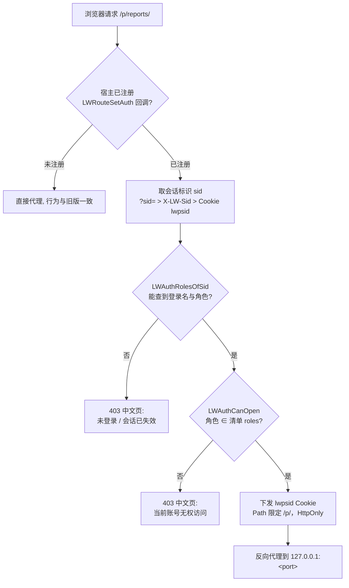

# pluginsDemo 插件用户权限实现说明

> 登录 + 角色 + `/p/` 路由强制鉴权
> 与「插件启动守卫」相互独立的两层机制
> 最后更新：2026-11-24

---

## 一、它和「启动守卫」不是一回事

pluginsDemo 里现在有两道不同的门，容易混为一谈：

| | 启动守卫 | 用户权限（本文） |
| --- | --- | --- |
| 解决的问题 | **哪个进程能拉起插件 exe** | **哪个登录用户能打开哪个插件** |
| 判定时机 | 插件进程启动的那一瞬间 | 每次 `/p/<名>/...` 请求 |
| 依据 | nonce + token + 父进程名 | 会话里的登录名与角色 |
| 拒绝表现 | 提示「请从主程序进入」+ `Halt(3)` | HTTP 403 中文页面，请求不转发给插件 |
| 代码位置 | `common/upluginguard.pas` | `common/upluginauth.pas` + `host/ulogin.pas` + `src/core/lwroute.pas` |

一句话：守卫管「exe 谁能开」，权限管「页面谁能看」。插件被宿主正常拉起、监听端口，不代表任何用户都能通过宿主代理访问它。

---

## 二、三层判定链路



对应的三层实现：

| 层 | 文件 | 作用 |
| --- | --- | --- |
| 登录 | `host/ulogin.pas` | `TLWLoginForm` 子类。`OnLogin` 校验通过后把登录名与角色写进**会话变量**（`SessionSetVar`），不用全局变量——同一进程里多个浏览器就是多个不同用户 |
| 菜单 | `host/umain.pas` 的 `BuildMenu` | 逐个插件比对 `LWAuthCanOpen(会话角色, 清单 roles)`，无权限的插件根本不进侧栏；菜单头显示「插件导航（2 / 共 3）」 |
| 路由 | `src/core/lwroute.pas` | `/p/<名>/` 代理前调用宿主注册的回调，拒绝则回 403，**请求不会到达插件进程** |

### 为什么判定只有一份实现

`LWAuthCanOpen` 写在 `common/upluginauth.pas`，菜单和路由共用同一份判定。这不是代码洁癖，是为了避免两种典型的错位：

- 菜单看得见、点开却 403 —— 用户以为坏了；
- 菜单看不见、手敲 URL 却能进 —— 权限等于没做。

后一种正是「只在界面层做权限」的通病。

---

## 三、演示账号

口令统一为 `123456`，写在 `upluginauth.pas` 的 `LWAuthDemoPass` 常量里（明文只为演示，真实项目不要落源码）。

| 账号 | 角色 | 可见插件 | 说明 |
| --- | --- | --- | --- |
| `admin` | `admin` | 仪表盘、报表汇总、便签 | `admin` 是通配角色，清单里不必单独列出它 |
| `analyst` | `analyst` | 仪表盘、便签 | 直接敲 `/p/reports/` 得到 403 |
| `guest` | `guest` | 仅便签 | `/p/dash/`、`/p/reports/` 均为 403 |

顶栏加了「切换用户」按钮：点它把会话退回未认证（`Authenticated := False`）并换回登录窗体。框架的 dispatch 在未认证时只放行登录窗上的控件，主窗体不会被操作到。

---

## 四、清单里怎么写权限

权限配置放在插件清单 `*.plugin.ini`，一行：

```ini
; dashplug/dashplug.plugin.ini —— 管理员和数据分析员都能看
roles=admin,analyst
```

```ini
; reportsplug/reportsplug.plugin.ini —— 只给管理员
roles=admin
```

```ini
; notesplug/notesplug.plugin.ini —— 不写 roles = 所有已登录用户（含 guest）
; 注意：是「已登录用户」，不是「匿名访客」
```

三条规则：

1. `roles` 省略或留空 → 所有**已登录**用户可访问（未登录仍然 403）。
2. 逗号分隔，任一命中即放行。
3. `admin` 角色通配，拥有任何插件，不需要在每个清单里重复列举。

新增角色不需要改清单格式，也不需要改框架：在 `upluginauth.pas` 的账号表里加一条，角色字符串按需命名即可。

---

## 五、两个必须做的细节（否则权限形同虚设）

### 1. iframe 首次导航必须自己带会话号

浏览器不会替 iframe 继承宿主的 `?sid=`。宿主拼 iframe 地址时要显式带上：

```pascal
Result := Result + '&sid=' + sid;   // umain.pas, IframeHTML
```

完整形态大约是 `/p/notes/?v=0&sid=<会话标识>`。

### 2. 放行后要落一个 `lwpsid` Cookie

只校验入口 HTML 等于没有校验 —— iframe 里页面自己的相对路径、`/lw/api/event`、静态资源请求都不带 query，手敲 `/p/名/lw/api/event` 也能绕过入口。

所以 `lwroute` 在放行后下发：

```
Set-Cookie: lwpsid=<sid>; Path=/p/; HttpOnly; SameSite=Lax
```

`Path=/p/` 限定作用域，`HttpOnly` 防脚本读取，`SameSite=Lax` 配合 iframe 同站场景。之后子资源请求靠这个 Cookie 过鉴权，无需在 URL 里反复带 sid。

---

## 六、顺手修正的两个框架真实缺陷

这两个是在接入过程中撞出来的，和权限功能本身无关，但都属于「一直存在、只是没人撞上」的问题：

### 缺陷 1：`CustomHeaders.Add('Set-Cookie: ...')` 会被拆坏

`TStringList` 的 `NameValueSeparator` 是 `=`，于是：

```
Set-Cookie: lwlang=zh          →  Set-Cookie: lwlang: zh
```

浏览器收到的是畸形头，直接忽略。**写 Cookie 必须走 `AResponse.Cookies.Add`。**

`lwhttp.pas` 的 `SetLangCookie` 一直有这个问题 —— 语言 Cookie 从来没真正生效过，只是因为还有 `?lwlang=` 参数和默认语言兜底，所以一直没人发现。

### 缺陷 2：`GetCustomHeader('Cookie')` 读不到 Cookie

fcl-web 把 Cookie 头放在 `TRequest.Cookie` 属性上，不在 CustomHeaders 里。读法的正确顺序是先取属性、再回退到请求头：

```pascal
function RouteRawCookie(const ARequest): string;
begin
  Result := ARequest.Cookie;
  if Result = '' then
    Result := ARequest.GetCustomHeader('Cookie');
end;
```

`lwroute.RouteRawCookie` 和 `lwhttp.ReqLang` 两处都按这个方式改过了。

---

## 七、验证

回归脚本 `tests/t_pluginauth.py`（186 行）覆盖以下场景，全部通过：

- 未登录时三个插件全部 403；
- `admin` / `analyst` / `guest` 三种账号的菜单项与访问矩阵（可见的 200、不可见的 403）；
- Cookie 通道：不带 query、只带 `lwpsid` 仍 200；
- iframe 子资源（相对路径）请求放行；
- 伪造 sid 得 403；
- 主窗体存在「切换用户」按钮，注销后回到登录窗体，旧 sid 访问插件得 403。

其他检查：

- `demos/pluginsDemo/build.bat` 全量重编通过（4 个 exe）；
- `tests/run_fixed_regression.py` 加入鉴权断言后全绿；
- `lwnew --plugin` 生成的工程 `build-all.bat` 编译通过，单跑插件仍然 exit 3（守卫未受影响）。

手工冒烟：

```bash
# 未登录直接访问插件 → 403
curl -s --noproxy '*' -o /dev/null -w "%{http_code}\n" http://127.0.0.1:8878/p/reports/
```

---

## 八、边界与限制

- **权限判定在宿主代理层**。插件只监听 `127.0.0.1:<port>`，本机有权限运行程序的人绕过宿主、直连端口，不受权限约束；插件进程本身也不知道「现在是谁在点」。
- 要做到进程级隔离，只能让插件自己也带登录，或把 TCP 端口换成命名管道 / ACL 受限句柄 —— 那是另一个量级的改造。
- 会话标识走 Cookie + query，属于同机同站场景的常规做法，不防「本机有读权限的人」。
- 启动守卫那层同理：secret 编译在 exe 内，可被反推；两层合起来是「防误操作 + 提高门槛」，不是密码学强认证。

---

## 九、涉及文件

### 框架侧

| 文件 | 改动 |
| --- | --- |
| `src/core/lwroute.pas` | 新增 `TLWRouteAuthFunc` + `LWRouteSetAuth`（默认 `nil` = 不鉴权，旧行为完全不变）；`/p/` 代理前鉴权、403 中文页、放行后下发 `lwpsid`、301 补斜杠时保留 query；身份注入回调 `TLWRouteIdentityFunc` + `LWRouteSetIdentity`，`ProxyTo` 先删同名头再写宿主签发的头 |
| `src/core/lwhttp.pas` | `SetLangCookie` 改用 `AResponse.Cookies.Add`；`ReqLang` 改用 `TRequest.Cookie` 读法；`HandleRequest` 把四个身份头读到 threadvar，事件里可读、请求结束清空 |

不注册回调时，`procdemo` 等不使用用户体系的工程行为与改动前完全一致，零开销。

### demo 侧

| 文件 | 说明 |
| --- | --- |
| `demos/pluginsDemo/common/upluginauth.pas` | 账号表、角色解析、会话变量读写、`LWAuthCanOpen` 统一判定、`AuthGuard`（供 `lwroute` 回调）、`AuthRegister`；`LWAuthIdentity` 签发 user/roles/token/ts |
| `demos/pluginsDemo/common/upluginidentity.pas` | 插件侧：用同一个 secret 验签，暴露 `PlugIdentityUser/Roles/Display`，失败返回空 |
| `demos/pluginsDemo/host/ulogin.pas` | `TLWLoginForm` 子类；**图形验证码默认开启**，只给自动化留显式开关（`--no-captcha` / `LW_LOGIN_NO_CAPTCHA=1`）；口令文案引用 `LWAuthDemoPass` 常量，避免与账号表各写一份；关验证码必须同时设 `RequireCaptcha := False`（只藏控件会永远报「验证码错误」） |
| `demos/pluginsDemo/host/umain.pas` | 按角色过滤菜单、顶栏用户标签、切换用户、`OpenPlugin` 二次校验、默认打开第一个有权限的插件、`IframeHTML` 拼 `&sid=` |
| `demos/pluginsDemo/host/pluginsdemo.lpr` | `SetLogin` + `AuthRegister`，在 `TLWApp.Run` 之前完成 |
| `dashplug/dashplug.plugin.ini` | `roles=admin,analyst` |
| `reportsplug/reportsplug.plugin.ini` | `roles=admin` |
| `notesplug/notesplug.plugin.ini` | 不写 `roles`（所有已登录用户） |
| `notesplug/uform_notes.pas` / `.lfm` | 右上角「当前用户」标签与状态栏身份，`uses upluginidentity` |
| `dashplug/`、`reportsplug/` | `.lpi` 已含 `../common` 路径，随时可 `uses upluginidentity`；本次未改界面（身份注入对所有插件生效，用不用随插件） |

### 文档与测试

| 文件 | 说明 |
| --- | --- |
| `demos/pluginsDemo/README.md` | 新增「用户权限」章节 |
| `docs/MANUAL.md`、`docs/FEATURES.md` | 各补一句插件权限说明 |
| `docs/NOTES.md` | 坑 199：Cookie 写法与读取的两个陷阱 |
| `tests/t_pluginauth.py` | 权限回归测试（含身份注入 5 项断言），34 项全绿 |
| `tests/run_fixed_regression.py` | 增加鉴权相关断言 |

---

## 十、接入到自己工程的步骤

1. 宿主 `.lpr` 的 `TLWApp.Run` 之前调用一次：

   ```pascal
   LWRouteSetAuth(@AuthGuard);   // 来自 upluginauth
   ```

2. 给主窗体设登录窗体：

   ```pascal
   SetLogin(TLoginForm);
   ```

3. 在插件清单里写 `roles=`。

4. 菜单生成处用 `LWAuthCanOpen` 过滤（不必须，但建议做，避免出现点开就 403 的死链）。

5. 拼 iframe 地址时带上 `&sid=`。

不用用户体系的工程什么都不用做 —— 回调不注册时 `lwroute` 行为与旧版一致。

---

## 十一、插件如何拿到当前登录用户（身份注入，2026-11-24）

权限判定在宿主进程，但插件是独立 exe、有自己的会话表 —— 宿主会话里的
`lwuser` / `lwroles` 不会自动出现在插件里。要做「便签页显示当前用户」这类
功能，得显式把身份送过去。

### 链路

1. `lwroute.LWRouteDispatch`：鉴权通过后调 `GRouteIdentity(sid, user, roles,
   token, ts)`；这个回调与鉴权回调相互独立，只注册 identity 也行。
2. `ProxyTo`：**先删掉客户端自带的同名头**，再写 `X-LW-User`、`X-LW-Roles`、
   `X-LW-Identity-Ts`、`X-LW-Identity-Token`；没签发时删干净，插件读不到旧值。
3. `lwhttp.HandleRequest` 把四个头读到 threadvar，业务事件里可读，`finally`
   清空 —— 连接线程会复用，不清空会把上一个用户的身份带给下一个请求。
4. 插件 `common/upluginidentity.pas` 用同一个 secret 验签（60 秒有效），对外
   暴露 `PlugIdentityUser/Roles/Display`。
5. 便签页 `lblIdentity` 显示身份，保存时身份进入状态栏。

### 为什么要签名、为什么要先删再写

只透传客户端头再追加 `X-LW-User` 等于没防：浏览器自己发一个
`X-LW-User: admin` 就能在插件里冒充管理员。宿主先删除同名头再写自己的值，
并用 `SHA1(secret + '|' + user + '|' + roles + '|' + ts)` 签名；插件算不出
token 就当没身份。secret 复用 `upluginguard` 的常量，两边共用单元。

### 边界

签名只证明「这个头是宿主在最近 60 秒内签的」，不证明「请求确实来自宿主进程」：
本机抓包拿到完整头的人可以在窗口内重放。要更强只能让插件校验调用方进程身份，
或走 ACL 受限的 IPC。

### 验证

`tests/t_pluginauth.py` 第 6 组断言：三个账号在便签页显示各自中文名、浏览器
伪造头被宿主覆盖、直连 8882 端口伪造头显示「未识别」。
