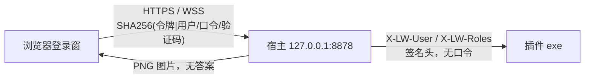

# pluginsDemo 登录凭据传输安全分析

> 对象：用户 / 口令 / 验证码从浏览器到宿主服务端、再到插件的传输链路
> 结论一句话：**TLS 加密链路 + 一次性挑战 SHA-256（口令原文不进载荷）；宿主到插件只传签名身份，不传口令。**
> 分析日期：2026-11-24（同日完成 TLS 与字段级加固）
> 说明：下文「明文」指字段以原值上报；两层加固后，字段是摘要、链路是 TLS

---

## 零、已落实的加固（2026-11-24）

### 0.1 传输层：TLS

`host/pluginsdemo.ini` 已开启 TLS：

```ini
ssl=1
sslcert=..\..\..\cert-ca\server-chain.pem
sslkey=..\..\..\cert-ca\server.key
```

实测验证：

- `https://127.0.0.1:8878/` 返回 200，启动日志 `Listen: https://...`、`TLS: 开`；
- 明文 HTTP 端口连接被重置（不再提供 `http://` 服务）；
- 证书 SAN 含 `localhost` / `127.0.0.1`（及局域网 IP），WebSocket 随页面协议自动切 `wss://`。

### 0.2 字段层：一次性挑战 + SHA-256

`host/ulogin.pas` 的 `AfterConstruction` 已设 `SecureLogin := True`。
浏览器提交登录时不再上报原文，而是：

```
edUser = SHA256(验证码令牌 | trim(小写用户名))
edPass = SHA256(验证码令牌 | 口令原文)
edCode = SHA256(验证码令牌 | trim(大写验证码))
```

- 令牌 = `TLWCaptcha.Token`，每次换图重新生成，校验一次即作废；
- 服务端 `LWCaptchaCheckHashed` 复算验证码答案摘要比对；
- 业务层 `LWAuthLoginHashed` 复算账户名/口令摘要比对，命中后把**真实用户名**
  写进会话（不是摘要）；
- 抓包拿到的只是本次令牌有效的摘要，换会话或换图都不能重放；口令原文
  不进入事件载荷、不进 WebSocket 帧、不进访问日志。

实测（2026-11-24）：

| 用例 | 结果 |
| --- | --- |
| 正确用户名 + 正确口令 + 正确验证码（摘要） | 登录成功，`forms=MainForm`，日志 `user=admin` |
| 正确用户名 + 错误口令（摘要） | 拒绝，仍停留 `TLoginForm` |
| 用旧会话的摘要向新会话重放 | 拒绝，仍停留 `TLoginForm` |
| `--no-captcha`（无令牌） | 自动退回明文登录，`securelogin` 不下发 |

字段层默认关闭，属于框架能力（`TLWLoginForm.SecureLogin`）；其他 demo
不设置就保持原行为。

---

## 一、结论速览

| 环节 | 字段形态 | 传输层 | 说明 |
| --- | --- | --- | --- |
| 浏览器 → 宿主（登录 POST / WebSocket） | **SHA-256 摘要** | **HTTPS / WSS** | 三项字段均为 `SHA256(令牌\|值)`，口令原文不出浏览器 |
| 服务端 → 浏览器（验证码图片） | PNG | HTTPS | 答案留在进程内，不下发 |
| 宿主 → 插件（反代） | 签名身份头 | 本机回环 | 只有 `X-LW-User` / `X-LW-Roles`，60 秒有效；口令不外传 |
| 服务端日志 | — | — | 只记真实 user / roles，事件层只记耗时与字节数 |

---

## 二、原明文路径（加固前）

> 下面记录的是未开 `SecureLogin` 时的行为，作为机制说明保留；
> 本 demo 现在走的是第零节的摘要路径。

### 2.1 事件载荷把整个登录窗的值打包上报

登录时点按钮，浏览器把登录窗体所有输入控件的值收进 `vals`，以 JSON 发 `POST /lw/api/event`；WebSocket 可用时改发同构的 `ws://` 帧。未启用挑战-响应时，用户、口令、验证码三者都是**纯文本**，没有任何客户端侧哈希或加密。

证据位置：

- `lw-alpine.js:666-690`、`lw.js` —— 事件载荷的组装与发送
- `lwdispatch.pas:950` —— 服务端事件入口把 `vals` 写回控件镜像

### 2.2 服务端必须拿到明文才能校验

框架的机制决定了服务端拿到的是明文文本：事件处理先把 `vals` 写回服务端控件镜像，`TryLogin` 再读 `edUser/edPass/edCode` 的文本做校验。

证据位置：

- `lwdispatch.pas:950`
- `lwlogin.pas:304-344`

### 2.3 demo 没开 TLS

框架默认 `UseSSL=False`（`lwapp.pas:633`）；**原 demo 未配置 `ssl=1`，链路是明文的 `http://127.0.0.1:8878`**——这正是本次加固前的问题，现已按第零节开启 TLS。



---

## 三、哪些地方不是明文 / 风险较低

### 3.1 验证码答案不下发

`/lw/api/captcha` 只返回 PNG 图片，答案存在进程内的「令牌 → 答案」表，校验一次即作废（`lwcaptcha.pas`、`lwhttp.pas:2126-2156`）。

浏览器抓包能看到图片，**看不到答案本身**；开启 `SecureLogin` 后连用户输入的码也只上报摘要，令牌一次即废。

### 3.2 宿主 → 插件不传口令

登录后反向代理只带 `X-LW-User` / `X-LW-Roles` 的签名头（60 秒有效），插件验签后读取身份，全程接触不到口令。这部分设计本身就是最小披露。

### 3.3 日志不记口令

登录日志只写 user / roles（`ulogin.pas:136`），事件层只记耗时和字节数。抓日志拿不到口令。

---

## 四、需要注意的几点

### 4.1 风险范围取决于监听地址

- 未开 TLS 时，一旦宿主绑定局域网地址供手机 / 同事访问，同一网段抓包可直接拿到口令；
- 本 demo 已开 TLS，局域网同样受 HTTPS 保护；手机首次访问自签证书会告警，属预期现象。

### 4.2 密码框内容会回传到浏览器

`lwwriter.pas:1546` 会把 `TEdit.Text` 序列化下发，`password` 字段只是告诉浏览器用 `type=password` 显示。**开启 `SecureLogin` 后服务端控件里存的是摘要**，回传的也是摘要，不再是口令原文；未开启时口令仍会跟着快照 / 补丁流回浏览器。

这是同一会话内的数据回流，不是跨用户泄露，但框架没有「密码字段不回传」的特例，评估时要注意浏览器内存 / 调试工具也能看到。

### 4.3 Cookie 缺 Secure 标志

`lwpsid` 有 `HttpOnly` + `SameSite=Lax`，但没设 `Secure`（`lwroute.pas:724`）。demo 已走 HTTPS，建议框架侧后续给该 Cookie 补 `Secure`（本次未改核心源码）。

### 4.4 演示口令直接写在界面上

登录标题直接显示 `LWAuthDemoPass`（`ulogin.pas:66`）。这是演示便利，**真实项目必须去掉**。

### 4.5 验证码调试开关

`LW_CAPTCHA_DEBUG` 环境变量会把验证码答案打到 stderr，只适合排障，生产环境不要开启。

---

## 五、加固办法

### 5.1 给宿主开 TLS（已落实）

demo 的 `host/pluginsdemo.ini` 已配置：

```ini
ssl=1
sslcert=..\..\..\cert-ca\server-chain.pem
sslkey=..\..\..\cert-ca\server.key
```

执行 `host\pluginsdemo.exe` 即可看到 `Listen: https://127.0.0.1:8878/`。命令行等价写法：

```
--ssl --ssl-cert=cert/server-chain.pem --ssl-key=cert/server.key
```

实现细节：

- 框架用纯 FPC 的 `TFPHttpServer.UseSSL` + `opensslsockets`
- Windows 需带 `libssl-3-x64.dll`、`libcrypto-3-x64.dll`
- 不指定证书时框架自动生成自签证书（浏览器会告警，属预期现象）
- 开启后 WebSocket 自动从 `ws:` 切到 `wss:`（`lw-alpine.js:4528`）

`http://` 与 `ws://` 分别变为 `https://` 与 `wss://`，浏览器侧传输明文问题即解决。

### 5.2 字段级挑战-响应（已落实）

`host/ulogin.pas`：

```pascal
SecureLogin := True;   // AfterConstruction；依赖窗体上的 TLWCaptcha
```

`OnLogin` 里按是否安全模式分流：

```pascal
if SecureLoginActive then
  AOk := LWAuthLoginHashed(AUser, APass, LoginNonce, RealUser, Roles, Disp, Err)
else
  AOk := LWAuthLogin(AUser, APass, Roles, Disp, Err);
LWAuthSessionSet(RealUser, Roles);
```

框架侧实现：`lwbase.LWSha256Hex`、`lwcaptcha.LWCaptchaCheckHashed`、
`lwlogin.SecureLogin/LoginNonce`、`lwwriter` 输出 `securelogin`、
`lw-alpine.js` 的 `sha256Hex` 与 `secureVals`。

### 5.3 其他建议

1. 真实工程不要沿用演示账号口令。
2. 去掉登录标题里的口令提示（`ulogin.pas:66`）。
3. 给 `lwpsid` Cookie 补 `Secure` 标志。
4. 生产环境关闭 `LW_CAPTCHA_DEBUG`。

---

## 六、安全边界说明

| 能力 | 能做到 | 做不到 |
| --- | --- | --- |
| TLS | 加密浏览器 ↔ 宿主链路 | 不解决端点被攻陷的问题 |
| 一次性挑战 + SHA-256 | 口令原文不出浏览器；摘要换会话/换图即失效 | 服务端若只存不可逆口令哈希则无法验证，需 SRP/PAKE |
| 身份签名头（宿主 → 插件） | 防止插件侧伪造用户身份 | 不防同机抓包与重放（60 秒内） |
| 验证码 | 阻挡自动化脚本盲猜 | 不防人工识别 |

本文结论基于 2026-11-24 的源码快照；Linux 环境下未在本机实机运行宿主进程验证网络行为，相关结论以源码路径为准。

---

## 七、相关文档

- `docs/插件用户权限实现说明.md` —— 登录、角色、菜单过滤与 `/p/` 路由鉴权
- `docs/SECURITY.md` —— 框架安全章节
- `README.md` —— 插件 demo 总览与启动方式
